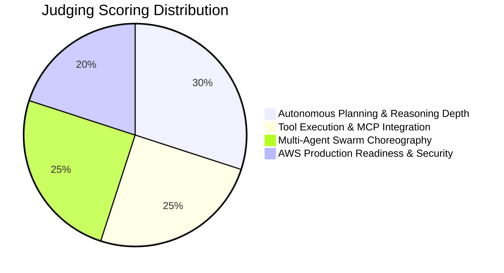

# 01 — Challenge Overview: Strands SDK: Workshop to Ship

> **AWS Builder Center Hackathon Reference Sheet**

---

## 1. Challenge Details & Metadata

| Attribute | Details |
| :--- | :--- |
| **Official Title** | Strands SDK: Workshop to Ship |
| **Host** | AWS Builder Center |
| **Status** | Live |
| **Start Date** | October 28, 2026 |
| **End Date / Deadline** | November 4, 2026 (11:59 PM PST) |
| **Duration** | 7 Days |
| **Format** | Online / Virtual, Public, Open to all builders |
| **Foundation Workshop** | *"Building AI Agents with Strands SDK: From Simple Loops to Multi-Agent Swarms"* |
| **Submission Platform** | AWS Builder Center Projects Portal |

---

## 2. Core Prompt & Problem Statement

> *"Take the workshop, Building AI Agents with Strands SDK: From Simple Loops to Multi-Agent Swarms, then build and ship a production AI agent system on AWS."*

Artificial Intelligence is shifting rapidly from passive text generation to **autonomous agentic systems** capable of reasoning, planning, executing code, using tools, and collaborating in swarms. The **Strands SDK: Workshop to Ship** hackathon challenges developers to take the lessons from the official AWS Strands workshop and construct an end-to-end, multi-agent AI application backed by **Amazon Bedrock** and deployed onto cloud infrastructure.

---

## 3. Mandatory Submission Deliverables

1. **Working AI Agent / Multi-Agent Swarm**:
   - Built using the **Strands Agents SDK** (Python or TypeScript).
   - Solves a non-trivial, multi-step problem using autonomous planning, tool invocation, and reflection.
   - Leverages **Amazon Bedrock** as the foundation model provider (e.g. Anthropic Claude 3.5 Sonnet, Claude 3.5 Haiku, Llama 3.3).
2. **Tools & Protocol Integration**:
   - The agent(s) must interface with real execution tools (e.g. APIs, AWS SDKs, database lookups, code execution sandboxes, or Model Context Protocol / MCP servers).
3. **Cloud Production Deployment / AgentCore Architecture**:
   - Clear architectural path to cloud execution (e.g. AWS Lambda, ECS Fargate, or Amazon Bedrock AgentCore persistence/memory).
4. **Public Code Repository & 3-Minute Video Demo**:
   - A public GitHub/GitLab repository with clean code, environment setup instructions (`.env.example`), and architectural diagram.
   - A concise video walkthrough (under 3 minutes) displaying the agent's reasoning trace, tool invocation, and final output.

---

## 4. Evaluation Criteria & Scoring Weightage

1. **Autonomous Planning & Reasoning Depth (30%)**:
   - Does the agent demonstrate genuine multi-step problem-solving rather than hardcoded linear scripts?
   - How well does the system handle error recovery, reflection, and edge cases?
2. **Tool Execution & MCP Integration (25%)**:
   - Are tools cleanly defined with typed schemas, clear docstrings, and robust error handling?
   - Does the agent make intelligent decisions about when and how to call external tools?
3. **Multi-Agent Swarm Choreography (25%)**:
   - How effectively do specialized agents interact (e.g. Supervisor-Worker, Planner-Executor-Critic, or Peer Swarm)?
   - Is context passed efficiently without token bloat?
4. **AWS Production Readiness & Security (20%)**:
   - Clean integration with Amazon Bedrock foundation models.
   - Safe execution practices (IAM least privilege, sandboxed execution, guardrails preventing prompt injection).

