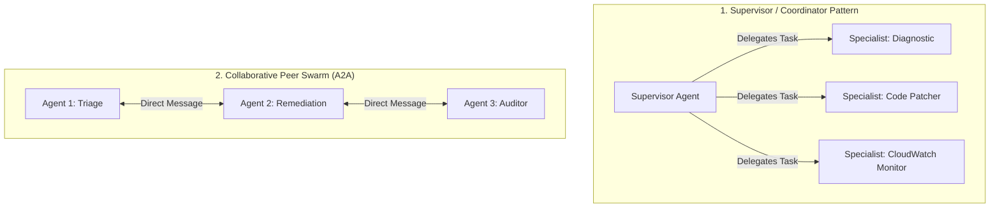

# 02 — Strands SDK Deep Dive: Architecture & Core Primitives

This document explores the architectural philosophy, technical primitives, and design patterns of the **Strands Agents SDK**.

---

## 🧬 1. The Core Philosophy: "Two Strands"

Traditional agent frameworks often suffer from excessive abstraction: they force developers into rigid state-machine graphs, require heavy external control planes, or introduce brittle prompt abstractions. 

The **Strands Agents SDK** takes a fundamentally different, model-driven approach inspired by the **two strands of DNA**:

```
        STRAND 1: Foundation Model (Amazon Bedrock)
                     ▲  │
                     │  │  Reasoning & Tool Selection
                     │  ▼
        STRAND 2: Execution Tools (Python/TypeScript Functions)
```

1. **Lightweight Agent Harness:** Strands is not an opaque cloud platform. It runs natively inside your own application process (FastAPI, Express, AWS Lambda, or CLI).
2. **Model-Driven Execution:** Rather than hardcoding every transition, Strands relies on state-of-the-art LLMs (Claude 3.5 Sonnet, Llama 3) to perform native planning, tool selection, reflection, and argument synthesis.
3. **Pure Function Tools:** Any standard Python function with type hints and a descriptive docstring immediately becomes an agent tool.

---

## 🧩 2. Core Strands Primitives

### A. The Agent Loop
At the heart of Strands is the execution harness:
1. **User Goal Ingestion:** The agent receives a natural language objective.
2. **Context Assembly:** System prompt + conversation history + tool definitions formatted into the model's native tool schema.
3. **Model Invocation:** The model evaluates whether the task is complete or if tools are required.
4. **Tool Execution:** If tool calls are requested, Strands executes the native functions locally or asynchronously, collects results, and returns them to the model context.
5. **Reflection & Termination:** The model inspects tool outputs, determines if further steps are needed, and loops until the objective is fulfilled.

```python
from strands import Agent
from strands.models import BedrockModel

# 1. Initialize model via Amazon Bedrock
model = BedrockModel(
    model_id="anthropic.claude-3-5-sonnet-20241022-v2:0",
    region_name="us-east-1"
)

# 2. Define a native tool
def lookup_cloudwatch_metrics(service_name: str, metric_name: str) -> dict:
    """Queries AWS CloudWatch for operational metrics over the past 15 minutes.
    
    Args:
        service_name: The AWS service or resource ID (e.g., 'orders-lambda').
        metric_name: The metric to query (e.g., 'Errors', 'Duration', 'Throttles').
    """
    # Native AWS SDK / Boto3 logic here
    return {"status": "ok", "error_rate": "14.2%", "threshold_exceeded": True}

# 3. Create the agent
agent = Agent(
    model=model,
    tools=[lookup_cloudwatch_metrics],
    system_prompt="You are an autonomous Cloud Reliability Engineer. Analyze telemetry and identify root causes."
)

# 4. Run the autonomous loop
response = agent.run("Check why our orders-lambda service is alarming right now.")
print(response)
```

---

## 🐝 3. Multi-Agent Swarm Topologies

Strands supports multiple agent collaboration patterns:



### 1. Supervisor / Hierarchical Delegation
A high-level "Director" or "Supervisor" agent receives the primary user prompt, breaks it down into subtasks, and invokes specialized sub-agents as tools.
- *Best for:* Strict quality control, bounded tasks, and clear separation of concerns.

### 2. Peer Swarm (Agent-to-Agent / A2A)
Specialized agents communicate directly with each other over a shared blackboard or messaging protocol.
- *Best for:* Open-ended research, debate-and-verify loops, and multi-domain consensus.

---

## 🛡️ 4. Guardrails & Observability Integration

Strands agents in production should never run unmonitored:
- **Bedrock Guardrails:** Block PII leakage, harmful content, and off-topic conversations before they reach the model.
- **OpenTelemetry / Langfuse / OpenInference:** Native hooks in Strands record latency, token spend, tool invocation arguments, and execution traces for full observability.

