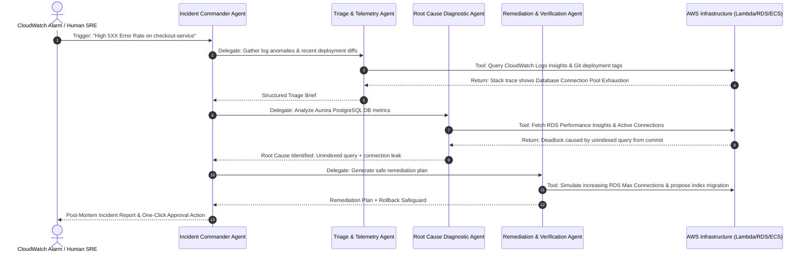

# 03 — Project Ideas & Agent Swarms: Strands SDK

This guide presents 3 enterprise-grade multi-agent project blueprints designed to showcase the full power of the **Strands Agents SDK** and **Amazon Bedrock**.

---

## 🏆 Project Concepts Comparison Matrix

| Project Concept | Domain | Swarm Topology | Key AWS Services | Judging Appeal | Feasibility |
| :--- | :--- | :--- | :--- | :--- | :--- |
| **1. CloudOps Swarm: Autonomous AWS Incident Triaging & Self-Healing** *(Top Recommendation)* | Cloud SRE / DevOps / Security | **Hierarchical Supervisor + 3 Specialist Workers** (Triage, Diagnostic, Remediation) | Amazon Bedrock (Claude 3.5 Sonnet), CloudWatch, AWS Health API, Lambda, DynamoDB | ⭐⭐⭐⭐⭐ Highest enterprise value & AWS alignment | High (5–6 days) |
| **2. CodeSentinel: Autonomous Security Auditor & PR Fixer** | DevSecOps / Code Intelligence | **Iterative Dual-Agent (Auditor + Patcher + Verifier)** | Bedrock, Amazon CodeCommit/GitHub API, Docker/Lambda Sandbox | ⭐⭐⭐⭐⭐ Demonstrates deep agent reflection & code synthesis | High (5 days) |
| **3. CarbonPulse: Enterprise Cloud Sustainability & FinOps Swarm** | Cloud Financial & Green Ops | **Pipeline Swarm (Collector -> Analyzer -> Optimizer -> Reporter)** | Bedrock, AWS Cost Explorer API, AWS Customer Carbon Footprint Tool, SES | ⭐⭐⭐⭐ Strong ESG and cost narrative | Medium-High (4–5 days) |

---

## 🚨 Deep Dive: Project 1 (Recommended Winner) — CloudOps Swarm

### The Problem
When a production cloud incident strikes at 3:00 AM, human on-call engineers spend 30 to 45 minutes manually sifting through CloudWatch alarms, correlating log traces, checking recent code deployments, and hunting for root causes. Meanwhile, downtime costs enterprises thousands of dollars every minute.

### The Solution: CloudOps Autonomous Swarm
A specialized swarm of 4 autonomous agents powered by Strands SDK and Amazon Bedrock that activates when a CloudWatch alarm triggers:

### The 4 Agents in the Swarm:
1. **Incident Commander (Supervisor Agent):**
   - Coordinates the incident lifecycle.
   - Manages shared incident state, decides which specialist to invoke, and synthesizes the final human-readable post-mortem.
2. **Telemetry & Log Triage Agent:**
   - Tools: `query_cloudwatch_insights()`, `fetch_metric_timeseries()`, `get_recent_deployments()`.
   - Filters millions of raw log entries into a concise summary of critical errors.
3. **Deep Diagnostic Agent:**
   - Tools: `inspect_database_metrics()`, `correlate_trace_spans()`, `fetch_git_commit_diff()`.
   - Pins down the exact code line, configuration change, or external dependency that caused the failure.
4. **Remediation & Patching Agent:**
   - Tools: `validate_remediation_safety()`, `execute_service_restart()`, `generate_patch_pr()`.
   - Proposes actionable remediation with automated safety checks, requiring human approval for high-risk actions.

---

## 🛡️ Deep Dive: Project 2 — CodeSentinel: Autonomous Security Auditor

### The Problem
Security scanners find hundreds of static vulnerabilities, but developers rarely fix them because triaging false positives and writing regression-safe patches takes hours.

### The Solution
CodeSentinel is a multi-agent PR review swarm:
1. **Security Vulnerability Scanner Agent:** Parses PR diffs and AST representations, identifying OWASP Top 10 vulnerabilities (SQLi, SSRF, IDOR, prompt injection).
2. **Test Generation Agent:** Generates a reproduction unit test that triggers the identified flaw.
3. **Surgical Patching Agent:** Writes the minimal code patch that resolves the flaw while keeping all existing unit tests green.

---

## 🌿 Deep Dive: Project 3 — CarbonPulse: FinOps & Sustainability Swarm

### The Problem
Companies waste millions on overprovisioned cloud resources, leading to unnecessary carbon emissions and inflated AWS bills.

### The Solution
A 4-agent swarm that analyzes monthly AWS Cost & Usage Reports (CUR), identifies idle EC2 instances, unattached EBS volumes, and oversized RDS instances, and drafts automated rightsizing scripts with carbon-offset projections.

---

## 💡 Strategic Recommendation

> **Recommendation:**  
> Choose **Project 1: CloudOps Swarm**.
> - It directly addresses real AWS infrastructure that judges live and breathe every day.
> - It cleanly demonstrates all levels of the Strands SDK workshop: single loop -> tools -> multi-agent supervisor/worker swarm -> production deployment on Bedrock.
> - The live demo is thrilling to watch: triggering a simulated production outage and watching the agents autonomously collaborate to diagnose and patch it in under 60 seconds!

