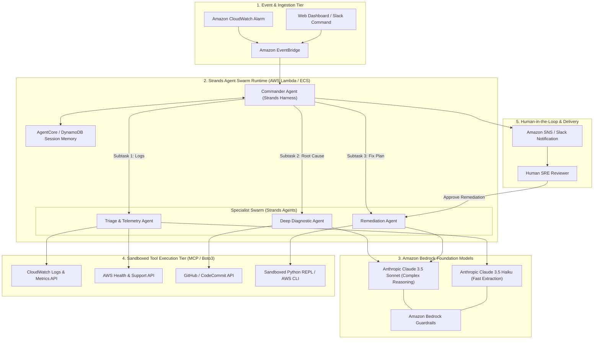

# 04 — System Architecture: Strands SDK: Workshop to Ship

This document details the production cloud architecture for the **CloudOps Autonomous Incident Swarm**, bridging local Strands SDK loops with **Amazon Bedrock** and **AWS Serverless infrastructure**.

---

## 🏛️ End-to-End System Architecture Diagram

---

## 🔍 Core Architectural Subsystems

### 1. The Strands Agent Execution Harness
- **Runtime Environment:** Containerized AWS Lambda function (Docker image with Python 3.12, Strands SDK, and AWS Boto3 SDK) or Amazon ECS Fargate task for long-running investigations (>15 minutes).
- **Concurrency & State Isolation:** Each incident gets a unique `IncidentId` (UUID). All specialist agents read from and write to a shared session blackboard persisted in **Amazon DynamoDB** or **Bedrock AgentCore Memory**.

### 2. Foundation Model Tier (Amazon Bedrock)
- **Primary Reasoner:** `anthropic.claude-3-5-sonnet-20241022-v2:0`
  - Utilized for high-order architectural reasoning, code diff inspection, and multi-step diagnostic planning.
- **Fast Worker / Extraction Model:** `anthropic.claude-3-5-haiku-20241022-v1:0`
  - Utilized for rapid log filtering, error regex extraction, and initial triage classification with sub-second latency.
- **Bedrock Guardrails:**
  - Enforces prompt-injection filtering, redacts sensitive AWS access tokens or customer PII from log output, and prevents hallucinations outside cloud operations.

### 3. Tool Execution & MCP Gateway
All tools given to Strands agents are strictly typed and sandboxed:
- **`query_cloudwatch_insights(log_group, query, time_range_minutes)`**: Executes CloudWatch Logs Insights queries to pull stack traces.
- **`get_service_metrics(metric_name, namespace, dimensions)`**: Fetches timeseries data (error rates, 5XX spikes, CPU/memory saturation).
- **`fetch_git_commit_diff(repo, commit_hash)`**: Inspects recent code changes to correlate code deployments with error spikes.
- **`simulate_remediation_dry_run(action_type, parameters)`**: Verifies that proposed remediation (e.g. increasing connection pool size) is syntactically and architecturally safe without causing cascade failures.

### 4. Human-in-the-Loop (HITL) Safety Gate
Autonomous agents in production should never execute high-risk infrastructure mutations without human authorization.
- When the Remediation Agent formulates a fix (e.g., rolling back an ECS service or modifying an RDS parameter group), the Incident Commander generates a structured change request.
- An interactive notification is delivered via Slack / SNS with two buttons: **[Approve & Execute]** and **[Reject]**.
- Once clicked, the agent executes the change and monitors CloudWatch for recovery verification.

