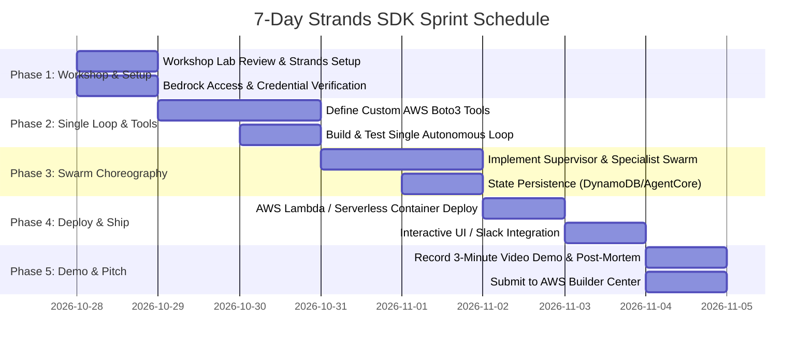

# 06 — Implementation Roadmap: Strands SDK: Workshop to Ship

> **7-Day Sprint Plan (October 28 – November 4)**

---

## ⏱️ Timeline Milestones At A Glance

---

## 📅 Day-by-Day Implementation Breakdown

### Day 1 (Oct 28): Workshop Grounding & Environment Setup
- **Goal:** Complete foundational workshop concepts and verify Amazon Bedrock connectivity.
- **Tasks:**
  1. Review the AWS workshop: *"Building AI Agents with Strands SDK: From Simple Loops to Multi-Agent Swarms"*.
  2. Install `strands-agents`, `boto3`, `pytest`, `pydantic`.
  3. Verify AWS credentials and Amazon Bedrock model access in `us-east-1` (invoke Claude 3.5 Sonnet / Haiku via a 5-line test script).
  4. Initialize Git repository with structured folders: `/agents`, `/tools`, `/memory`, `/tests`.

### Days 2–3 (Oct 29–30): Tool Harness & Single-Agent Verification
- **Goal:** Create robust, typed tool functions with real/mocked AWS telemetry.
- **Tasks:**
  1. Write **CloudWatch Tools**:
     - `query_cloudwatch_insights()`: Runs structured queries on error logs.
     - `get_metric_timeseries()`: Retrieves CPU/Memory/5XX metrics.
  2. Write **Code & Health Diagnostic Tools**:
     - `fetch_service_health()`: Calls AWS Health API.
     - `get_git_commit_diff()`: Retrieves git diffs between current deployment and previous tag.
  3. Write **Remediation Sandbox Tools**:
     - `simulate_service_scale()`: Calculates capacity changes.
     - `generate_remediation_diff()`: Formulates patches.
  4. Test individual tools with unit tests.

### Days 4–5 (Oct 31 – Nov 1): Multi-Agent Swarm Implementation
- **Goal:** Multi-agent collaboration with Incident Commander, Triage Agent, and Diagnostic Agent.
- **Tasks:**
  1. Implement **Triage Specialist Agent**:
     - System prompt tuned for rapid log parsing and anomaly detection.
  2. Implement **Deep Diagnostic Specialist Agent**:
     - System prompt tuned for causal root-cause analysis and code correlation.
  3. Implement **Remediation Specialist Agent**:
     - System prompt tuned for minimal, safe corrective actions and rollback plans.
  4. Implement **Incident Commander Supervisor**:
     - Orchestrates the specialists, maintains shared state, and formats final markdown incident report.
  5. Connect persistent session memory via DynamoDB.

### Day 6 (Nov 2–3): Cloud Packaging, Bedrock Guardrails & Web UI
- **Goal:** Package agents into AWS Lambda / container and provide a clean dashboard/CLI interface.
- **Tasks:**
  1. Attach Amazon Bedrock Guardrail to mask credentials and sanitize outputs.
  2. Package into Docker container for AWS Lambda execution with SAM or Serverless Framework.
  3. Build a lightweight UI (Streamlit, React, or terminal console) that visualizes:
     - Real-time agent thinking process (thoughts, tool calls, and outputs).
     - Swarm message graph.
     - Final formatted incident triage report.

### Day 7 (Nov 4): Video Demo, Documentation & Submission
- **Goal:** High-scoring submission submitted before the 11:59 PM PST deadline.
- **Tasks:**
  1. Record 3-minute demo video following [`07_SUBMISSION_AND_DEMO_GUIDE.md`](./07_SUBMISSION_AND_DEMO_GUIDE.md).
  2. Showcase a live simulated cloud outage: watch the agents detect the alarm, inspect the logs, isolate the root cause, and formulate a safe fix in real time.
  3. Write comprehensive GitHub `README.md` with system diagrams and setup guide.
  4. Submit final entry on AWS Builder Center!

